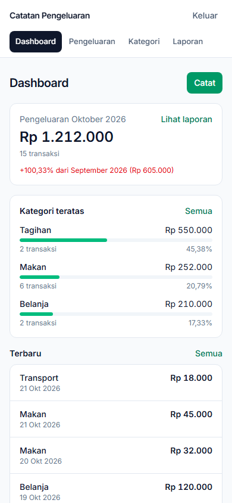
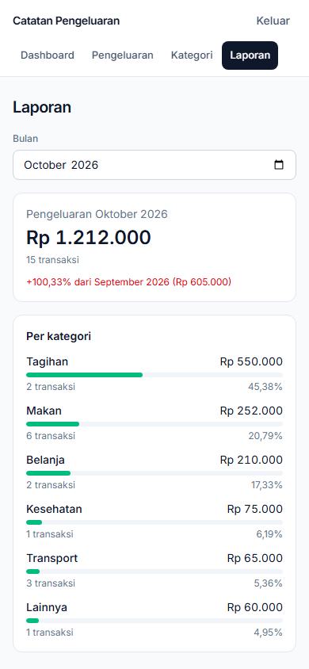
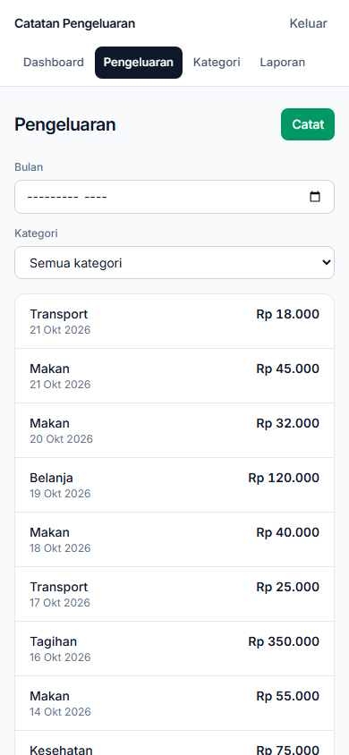
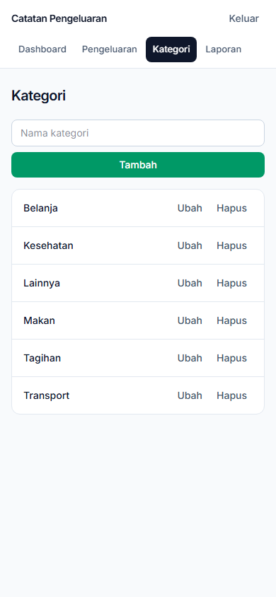
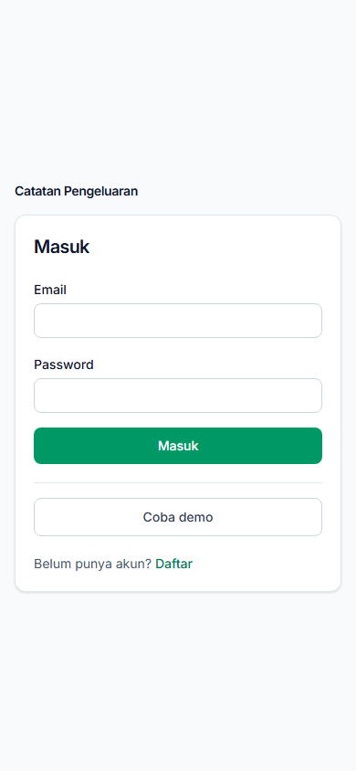

# Catatan Pengeluaran

A personal expense tracker: log spending, group it by category, and review a monthly report. Built as a fullstack portfolio project with a Laravel API and a React Router SPA, focused on clean API design, per-user data isolation, and a usable mobile-first UI.

> **Live demo:** deployment pending. Run it locally and use **Coba demo** on the login screen for a one-click tour.

## Screenshots

| Dashboard | Monthly report |
| :---: | :---: |
|  |  |
| **Expenses** | **Categories** |
|  |  |

Screenshots use the seeded demo dataset. The UI is in Indonesian; code, API fields, and documentation are in English.

## Features

- Email/password authentication with session cookies (Sanctum); every query is scoped to the signed-in user.
- Six default categories on registration, with rename and delete (delete is blocked while a category is in use).
- Expense CRUD with amount, date, category, and optional note.
- Expense list with month/category filters and 20-item pagination.
- Monthly report: total, transaction count, category breakdown with share bars, and comparison against the previous month.
- One-click demo login that resets a deterministic three-month dataset and signs the visitor in; limited to 3 requests/minute per IP.
- Responsive, mobile-first UI with dark-mode support and Indonesian validation messages.

## Tech stack

| Layer | Choice |
| --- | --- |
| API | Laravel 13, Sanctum, Eloquent API Resources |
| Database | PostgreSQL (tested on 18.4); SQLite in-memory for tests |
| Frontend | React Router 8 in SPA mode, React 19, TypeScript, Vite 8, Tailwind CSS 4 |
| Backend tests | Pest 5 |

## Architecture

The SPA and API ship as **one origin**. Laravel serves JSON under `/api/v1` and the built SPA shell for every other route; Vite serves the frontend during development and proxies `/api` and `/sanctum` to Laravel on port 8001. Authentication uses Sanctum's stateful cookie flow, so no access token is exposed to JavaScript.

In SPA mode the frontend uses React Router's `clientLoader`/`clientAction` data APIs and a small typed `fetch` client that sends credentials and the CSRF token. The production build is copied to `backend/public/spa`; see [ADR 0002](docs/adr/0002-single-origin-spa-with-sanctum-cookies.md) and [ADR 0003](docs/adr/0003-react-router-spa-mode.md).

Reports are computed from expenses with SQL aggregation and never stored. Money is an integer in rupiah, dates use `occurred_on` (`YYYY-MM-DD`), and month defaults use Asia/Jakarta. See [CONTEXT.md](CONTEXT.md) for scope and conventions and [GLOSSARY.md](GLOSSARY.md) for domain language.

## Run locally

### Prerequisites

- PHP 8.3+ with the `pdo_pgsql` extension
- Composer 2
- Node.js 22+ and npm
- PostgreSQL (tested on 18.4)
- No Docker required

### 1. Backend

```bash
git clone <repository-url>
cd <project-folder>/backend
composer install
cp .env.example .env       # PowerShell: Copy-Item .env.example .env
php artisan key:generate
```

Create the database and point `.env` at it:

```sql
CREATE DATABASE expense_tracker;
```

`.env.example` defaults to `127.0.0.1:5432`, database `expense_tracker`, user `postgres`, and an empty password. Adjust those values if your PostgreSQL setup differs.

```bash
php artisan migrate
```

Optional: seed the demo account up front with `php artisan demo:reset`.

### 2. Frontend

```bash
cd ../frontend
npm install
```

### 3. Development

From the project root, run two terminals:

```bash
# terminal 1
cd backend && php artisan serve --port=8001
```

```bash
# terminal 2
cd frontend && npm run dev
```

Open <http://localhost:5173>. The backend must stay on port 8001 because `frontend/vite.config.ts` proxies `/api` and `/sanctum` there. Sanctum accepts the Vite origin (`localhost:5173` / `127.0.0.1:5173`) as stateful by default.

### 4. Production-style build

From the project root:

```bash
cd frontend && npm run build          # also copies the SPA to backend/public/spa
cd ../backend && php artisan serve --port=8001
```

Open <http://127.0.0.1:8001>. Laravel now serves the built SPA at `/`, including deep links such as `/expenses`.

For a real deployment, set `APP_ENV=production`, `APP_DEBUG=false`, `APP_URL=https://your-domain`, database credentials, and `SESSION_SECURE_COOKIE=true`; then run `php artisan migrate --force` and point the web server document root at `backend/public`. The SPA build must run before the backend release because the two ship together.

## Demo account



Click **Coba demo** on `/login`. The endpoint resets the shared account `demo@expense-tracker.test` to a deterministic dataset (six categories, 30 expenses across roughly three months) and signs the visitor in. The password is random and not published.

- `php artisan demo:reset` performs the same reset from the CLI.
- The endpoint is public and rate limited to 3 requests per minute per IP.
- Every demo login resets any data a previous visitor added.

## API overview

All endpoints are prefixed with `/api/v1`. Everything except register, login, and demo-session requires the session cookie.

| Method | Path | Purpose |
| --- | --- | --- |
| POST | `/auth/register` | Create a user, seed default categories, sign in |
| POST | `/auth/login` | Sign in |
| POST | `/auth/logout` | Invalidate the session |
| GET | `/auth/user` | Current user |
| GET/POST | `/categories` | List / create categories |
| PATCH/DELETE | `/categories/{id}` | Rename / delete a category |
| GET/POST | `/expenses` | List (`?month=YYYY-MM&category_id=&page=`) / create |
| GET/PATCH/DELETE | `/expenses/{id}` | Detail / update / delete |
| GET | `/reports/monthly?month=YYYY-MM` | Totals, category breakdown, previous-month comparison |
| POST | `/demo-session` | Reset demo data and sign in (rate limited) |

Expense payloads use `category_id`, `amount` (positive integer), `occurred_on` (`YYYY-MM-DD`), and optional `note` (max 500 characters).

## Testing

From the project root:

```bash
cd backend && php artisan test --compact
```

```bash
cd frontend && npm run typecheck
```

The Pest suite runs against SQLite in memory and covers auth isolation, validation, category rules, expense CRUD and filters, monthly report math, and demo reset. Keep queries portable: development and production use PostgreSQL while tests use SQLite. Browser flows were verified manually during development; no browser test suite is committed yet.

## Project structure

```text
backend/    Laravel 13 API, migrations, Pest tests, SPA shell
frontend/   React Router 8 SPA (TypeScript, Tailwind 4)
docs/       ADRs and screenshots
CONTEXT.md  Product scope, conventions, and decision index
GLOSSARY.md Domain vocabulary
```

Generated SPA assets live in `backend/public/spa` and are ignored by Git.

## Decisions

- [ADR 0001](docs/adr/0001-postgres-over-sqlite.md) — PostgreSQL in dev and production, SQLite for tests.
- [ADR 0002](docs/adr/0002-single-origin-spa-with-sanctum-cookies.md) — serve the SPA from Laravel and use Sanctum cookies.
- [ADR 0003](docs/adr/0003-react-router-spa-mode.md) — React Router SPA mode with client loaders/actions.

## Known limitations

- No budgets, recurring expenses, CSV import/export, multi-currency, attachments, tags, password reset, or email verification.
- Login throttling is not implemented yet; only the demo endpoint has its own limiter.
- The shared demo account is intentionally destructive on every demo login.
- The frontend and backend deploy together; separate releases would require revisiting the auth design.
- UI copy is Indonesian only.
